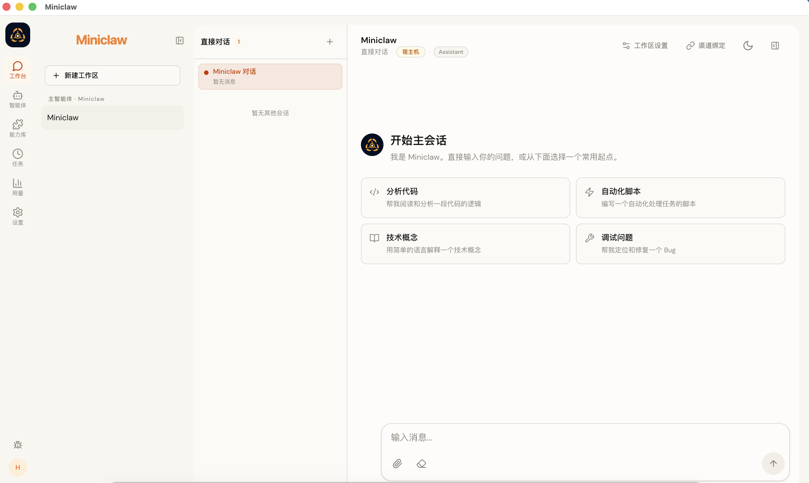
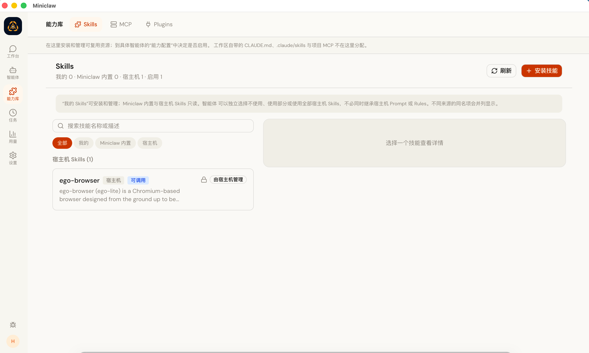
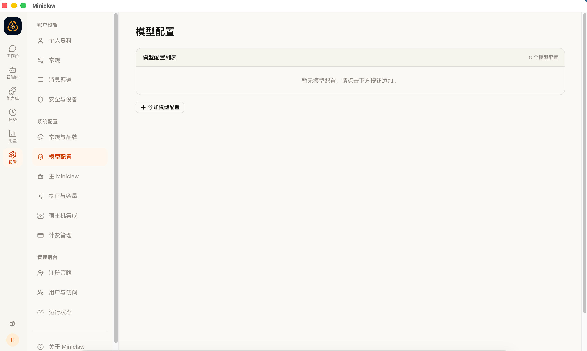

# 电商 Miniclaw

<p align="center">
  
</p>

<p align="center">
  <strong>自托管、多店铺多渠道的 AI 电商客服工作台</strong><br />
  把数字客服、店铺工作区、记忆、业务工具与消息渠道组织在同一个可控运行环境中。
</p>

<p align="center">
  
  
  
  
  
</p>

<p align="center">
  <a href="#界面预览">界面预览</a> ·
  <a href="#产品定位">定位</a> ·
  <a href="#核心能力">能力</a> ·
  <a href="#技术栈">技术栈</a> ·
  <a href="#架构">架构</a> ·
  <a href="#快速开始">快速开始</a> ·
  <a href="#测试与验证">测试</a> ·
  <a href="#文档">文档</a>
</p>

> 面向电商场景：每个店铺使用独立工作区，售前/售后数字员工按业务线分配，顾客在 Web、飞书、Telegram 等渠道的咨询可路由到对应店铺；商品、订单、物流与售后数据通过显式授权的工具接入。

## 界面预览



<p align="center"><sub>工作台：店铺会话、任务状态与工具调用在同一个界面中呈现</sub></p>



<p align="center"><sub>能力配置：Agent 的 Skills、MCP 与工具策略按工作区下发</sub></p>



<p align="center"><sub>模型设置：Provider、模型与故障转移策略</sub></p>

> 截图取自本地开发环境，数据为演示数据。

## 产品定位

电商 Miniclaw 基于完整 Miniclaw 工程与 Pi Agent Runtime，沿用智能体优先工作模型，保留认证、工作区、会话、记忆、渠道、任务与权限能力，并将默认产品身份和主 Agent 调整为电商客服场景。

- **多店铺隔离**：一个店铺对应一个独立 Workspace，文件、会话、记忆与渠道绑定按工作区隔离。
- **四段式人设**：身份 / 价值观 / 能力 / 规则四段独立配置，支持版本记录与回退。
- **多渠道接入**：Web、飞书、Telegram、QQ、钉钉、微信、Discord、WhatsApp 等渠道通过适配器接入。
- **数字员工**：内置“电商客服助手”，也可为售前、售后等业务线创建独立 Agent。
- **工具与自动化**：通过 MCP、Skills、Subagents 和定时任务连接已授权的商品、订单、物流与售后系统。

## 核心能力

| 能力 | 实现要点 |
| --- | --- |
| 多店铺数据隔离 | 智能体、Workspace、Session 三层模型；文件、会话、Memory 与渠道绑定均以 Workspace 为边界 |
| 四段式人设 | IDENTITY / SOUL / AGENTS / TOOLS 分段保存，支持版本记录、对比与回退 |
| 渠道适配 | 每个渠道独立适配器，统一消息、卡片与附件语义；核心业务不感知渠道差异 |
| 长期记忆 | Workspace Memory v2 落在 SQLite，带 item/store revision、CAS 并发控制、幂等键与 provenance |
| 任务执行 | 定时任务、队列与租约，支持重启后恢复未完成任务、回收卡住的 Runner、补偿投递游标 |
| 权限与审计 | RBAC、Workspace ACL、渠道绑定权限与写操作确认，关键动作留痕 |
| 桌面端 | Electron 外壳复用同一套后端与 Web 工作台，支持本地打包 |

## 默认电商客服

新用户首次创建内置 AgentProfile 时，会自动得到“电商客服助手”及四段式默认人设：

- **IDENTITY**：店铺数字员工，接待顾客并处理商品、订单物流与售后咨询。
- **SOUL**：热情耐心、不越权，不夸大商品效果，不承诺无法兑现的售后结果。
- **AGENTS**：按商品咨询、订单物流、退换货业务线工作，遵守店铺规则与操作确认流程。
- **TOOLS**：只使用当前店铺和当前顾客授权范围内的数据，不编造商品、订单、物流或售后结果。

旧的 `Default Agent` 与 `Miniclaw` 内置名称会迁移为“电商客服助手”；自定义 Agent 名称不会被强制改写。

## 电商系统接入边界

本仓库提供的是**完整电商客服工作台与 Agent 运行底座**，不虚构已经接入某个电商平台。具体店铺 SaaS、商品库、订单库、物流与退款接口仍需通过 MCP、Skills 或自有服务完成配置。

未配置对应工具时，客服可以处理通用咨询与流程说明，但不能声称查询到了真实库存、订单或物流状态，也不能直接执行退款、改价等操作。

## 架构

```text
Web Client / 消息渠道
       │ HTTP + WebSocket / Channel Adapters
       ▼
电商 Miniclaw Backend (Auth · API · Queue · Scheduler · ACL)
       │
  ┌────┴─────┬──────────┐
  ▼          ▼          ▼
Workspace  Capability  Channel
Session    Registry    Binding
Memory     Skills/MCP Delivery
       │
       ▼
Pi Agent Runner (Host / Docker)
       │
       ▼
Pi Agent Runtime — Tools · Extensions · Subagents
```

### 技术栈

| 层 | 技术 |
| --- | --- |
| 后端 | Node.js 20+、TypeScript、Hono、WebSocket |
| Agent 运行时 | Pi Agent Runtime（`@earendil-works/pi-coding-agent`） |
| 数据 | SQLite（better-sqlite3），事务、迁移与恢复测试 |
| Web 工作台 | React 19、Vite 6、Tailwind CSS 4、Zustand |
| 桌面端 | Electron 39、electron-builder |
| 渠道 | 飞书、Telegram、QQ、钉钉、微信、Discord、WhatsApp |
| 测试 | Vitest、Playwright |
| 部署 | 本机 Host 模式 / Docker 容器模式 |

### 项目结构

```text
config/      运行时、模型与渠道配置
container/   Agent Runner 镜像与容器内权限脚本
docs/        架构、API、ACL、Memory 文档与界面截图
electron/    桌面端主进程与预加载脚本
scripts/     构建、镜像发布、自检与运维脚本
shared/      跨端共享类型与工具
src/         后端服务、渠道适配、任务调度、Memory、权限
web/         Web 工作台前端
tests/       单元、契约、集成与 e2e 测试
```

## 快速开始

### 环境要求

- Node.js 20 或更高版本
- npm
- 如果使用容器执行模式，需要 Docker

### 安装与构建

```bash
npm install
npm --prefix web install
npm --prefix container/agent-runner install
npm run build:all
WEB_PORT=3000 npm start
```

Windows PowerShell 启动命令：

```powershell
$env:WEB_PORT=3000
npm start
```

默认地址：<http://127.0.0.1:3000>。首次进入时创建管理员并配置 Provider；渠道与模型配置也可以稍后补充。

### 开发模式

```bash
npm run dev:all
```

### 桌面端

```bash
npm run desktop:dev
npm run desktop:package
```

## 测试与验证

```bash
npm run typecheck
npm test -- --run
npm run build:all
npm run self-test
```

测试覆盖 Agent Builder、渠道适配与投递、Workspace Memory、任务调度与租约、数据库迁移、重启恢复与权限边界；`npm run self-test` 会依次构建并运行 Agent Runner 自检与完整测试集。

## 店铺接入建议

1. 为每个店铺建立独立 Workspace，不在多个店铺之间共用业务文件与 Memory。
2. 为售前、售后等角色配置独立 AgentProfile，并只开放所需工具。
3. 通过 MCP 或 Skills 接入商品、订单、物流和售后接口，按店铺配置权限。
4. 将渠道绑定到正确店铺 Workspace，先用测试顾客与测试订单验证路由。
5. 对退款、补偿、改价、地址修改等写操作保留人工确认与审计记录。

## 文档

- [`docs/API.md`](docs/API.md) — HTTP API、认证和主要资源接口
- [`docs/ACL-MATRIX.md`](docs/ACL-MATRIX.md) — 用户、Workspace、Channel、Host 与任务权限矩阵
- [`docs/workspace-memory-v2.md`](docs/workspace-memory-v2.md) — Workspace Memory 的数据模型、版本与交互边界
- [`docs/PROMPT-SKILL-RUNTIME-TEST-PLAN.md`](docs/PROMPT-SKILL-RUNTIME-TEST-PLAN.md) — Prompt、Skill、Runtime 与 Agent Builder 验证计划
- [`docs/agent-first-architecture-plan.md`](docs/agent-first-architecture-plan.md) — 智能体优先的分层与演进说明
- [`SECURITY.md`](SECURITY.md) — 安全问题报告与处理策略

## License

MIT License，详见 [`LICENSE`](LICENSE)。
